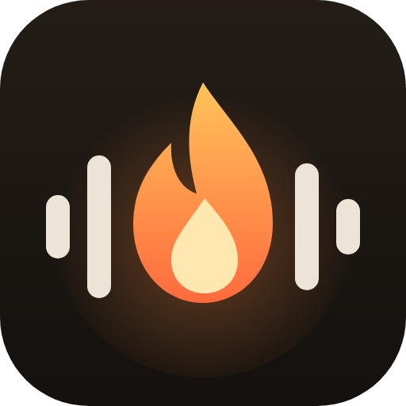

<p align="center"></p>

# Rushlight

**English** · [Français](README.fr.md)

A Premiere Pro extension that removes the silences from my recordings and shows me where the good parts are.

https://github.com/user-attachments/assets/a5f93bd5-0543-4eaa-9d22-c8ffb2d24b80

I started it because I was spending way too much time going through my gaming sessions. Three or four hours of
footage, with menus, downtime, moments where I don't say anything... Cutting all of that by hand is slow and
tedious. Rushlight listens to the sequence audio, cuts the dead air, closes up the timeline and drops markers on
the liveliest moments so I can find them quickly.

The project is still evolving: fixes and new features keep coming with each version.
See [CHANGELOG.md](CHANGELOG.md) for the history.

## What it does

The core of the extension is silence removal: it analyzes every audio track in the sequence, works out the right
threshold from the average sound level, then cuts and closes up the timeline. There are a few ready-made modes
depending on the kind of video (gaming, vlog, podcast, best of), and it can also remove quiet passages, not only
real silences.

Long sequences can be cut one hour at a time. Every hour that has been processed is marked in green and the
extension won't touch it again.

It can also spot highlights from the audio (voice getting louder, fast speech, exclamations, laughter) and build a
"best of" sequence with only those moments, without changing the original sequence.

And since cutting hours of footage automatically can go wrong, it backs up the project before every change and
checks every cut. At the slightest problem it stops and tells you which backup to reopen.

The panel is available in English and French: it follows Premiere's language, and you can change it in Settings.

## From a long session to Shorts, TikToks and clips

This is the part I use the most after cutting the silences. On a three-hour session, finding the five moments
worth posting usually means watching everything again. Rushlight does a first pass for you:

1. Click "Find new highlights": the most intense passages (raised voice, fast talking, exclamations, laughter) get
   an orange marker, numbered from best to least good, each with the reason it was picked.
2. Click a moment in the list to jump to it and check it. If it's not good, the cross removes it from the
   suggestions for good, and the next search brings new ones.
3. "Create a best-of sequence" puts all the moments you kept end to end in a new sequence, ready to trim and export,
   without touching your original edit.

With the Length setting you choose what you get: short 8-second moments for a hook or a fast-paced recap, or 20 to
30-second passages that work as standalone Shorts, TikToks or Reels. It only listens to the audio, so it won't
understand a quiet but important line, but it takes care of most of the searching.

## Installation

You need Windows, Premiere Pro 2021 or later and ffmpeg, which is used to analyze the audio.

Rushlight is tested on Premiere Pro 2026 (versions 26.0 and 26.5). It should also run on earlier versions: if you
try it on another one, feel free to let me know in an [issue](https://github.com/thepatatra/rushlight/issues) how
it went.

To install ffmpeg, in PowerShell:

```
winget install Gyan.FFmpeg
```

Then:

1. Download the `Rushlight-vX.Y.Z.zip` file from the latest
   [release](https://github.com/thepatatra/rushlight/releases/latest) and unzip it anywhere.
2. Close Premiere, then double-click `install.bat`.
3. Open Premiere again: the panel is in Window > Extensions > Rushlight.

Updating works the same way: download the new version and run `install.bat` again.

## How I use it

Before starting, the project must have been saved at least once. I also lock the tracks I don't want cut, like
background music.

1. I pick a mode at the top of the panel (Gaming for my gaming sessions) and leave "Automatic setting" checked.
2. I click Analyze. Nothing is changed at this point: the panel just shows the threshold it found, the number of
   cuts and how much time will be removed.
3. The first time on a new kind of video, I set the action to "Add markers only" and click Cut. It puts a red
   marker on every silence, so I can check the cuts land in the right places.
4. If it looks good, I set the action back to "Remove silences and close up", pick the zone (one hour, or all the
   remaining ones) and cut.
5. After a cut, run Analyze again before cutting the rest. Zones that are already done are skipped.

For highlights, set how many moments you want and how long they should be, then click "Find new highlights".
Orange markers appear, numbered from best to least good, and the list in the panel uses the same numbers (click
one to jump to it). The list is read back from the markers, so it is still there after closing Premiere.

If a moment isn't interesting, the small cross next to it marks it as "ignored" (white marker): it will never be
suggested again. Running the search again gives new moments, never the same ones, until the extension tells you
nothing else really stands out. "Clear all highlights" lets you start from scratch. A few settings that work well
for me:

| To make... | Count | Length |
|---|---|---|
| a hook at the start of a video | 3 | 5 s |
| a fast-paced best of | 10 | 8 s |
| Shorts / TikToks | 5 | 20 to 30 s |
| finding the big action scenes | 8 | 15 s |

## Settings

| Setting | What it does |
|---|---|
| Mode | Fills in the settings below. Changing one by hand switches the mode back to "Custom". |
| Automatic setting | Computes the silence threshold over the whole sequence. Moving the slider switches to manual, with an instant preview. |
| Min. silence length | Gaps shorter than this are not cut. |
| Padding before / after | Sound kept around each passage, so the start and end of words aren't cut off. |
| Also cut quiet passages | Also removes quiet stretches that last at least the given time. |
| Also close existing timeline gaps | Also closes the gaps that already existed between clips. |
| Zone to cut | One specific hour, or all remaining zones. |
| Settings > Language | Automatic (Premiere's language), English or French. |

Mode values:

| Mode | Min. silence | Padding before / after | Quiet passages | Highlights |
|---|---|---|---|---|
| Gaming | 800 ms | 150 / 400 ms | no | 8 × 15 s |
| Vlog / face cam | 350 ms | 80 / 120 ms | no | 5 × 10 s |
| Podcast / interview | 1000 ms | 200 / 300 ms | no | 5 × 20 s |
| Best of | 300 ms | 60 / 100 ms | yes, from 3 s | 10 × 8 s |

## Backups

Before every cut (and before every zone when several are cut in a row), the project is saved and then copied to a
`Rushlight - backups` folder next to the `.prproj` file. The names tell you when and why the copy was made, for
example `My Video_2026-10-27_14-05-12_before-cut-zone-1-of-4.prproj`. Nothing is ever overwritten.

To go back, open the backup you want with File > Open Project, then use "Save As" next to your usual project.

## Good to know

- Green markers protect zones that have already been cut. To cut a zone again, delete its marker. If a sequence
  was cut by hand, you can protect it with "Mark as already cut" (on the In/Out points, or the whole sequence).
- Locked tracks are never cut or moved.
- After a cut, the video and audio of each piece are linked again. On a sequence cut some other way, the "Relink
  audio and video" button does the same.
- Highlights are guessed from the audio only. The extension doesn't understand what is said, so an important line
  spoken calmly won't stand out.
- If a message starting with ⚠ appears, the extension stopped as a safety measure: just reopen the backup it
  mentions.

## Troubleshooting

- The panel doesn't show up: run `install.bat` again with Premiere closed.
- "ffmpeg not found": install ffmpeg (see above) or set its path in Settings.
- "Save the project once first": use File > Save once.
- Cuts too tight or too loose: try another mode, or adjust the padding and the minimum silence length.

Found a bug or have an idea? Open an [issue](https://github.com/thepatatra/rushlight/issues). To work on the
code, see the technical notes in [Rushlight/README.md](Rushlight/README.md).

## How it was made

A personal project, coded with the help of an AI (Claude) and designed, tested and tuned on my own videos.

## Before you use it

Rushlight is a personal project that I share for free, as is. I use it on my own videos and I've added quite a few
safeguards (automatic backups, checking every cut), but I can't guarantee it will work perfectly on every setup.
Always keep a copy of your important projects and check the result before publishing a video. I can't be held
responsible for a damaged project or lost work.

This is an independent project, not affiliated with Adobe. Premiere Pro is a trademark of Adobe.

The code is under the MIT license (see [LICENSE](LICENSE)): you can use, modify and share it freely, as long as
you keep the license notice.

## Support the project

Rushlight is and will stay free. If it saves you time on your edits, you can buy me a pizza on Ko-fi, it helps me
keep improving it.

[](https://ko-fi.com/rushlight)
